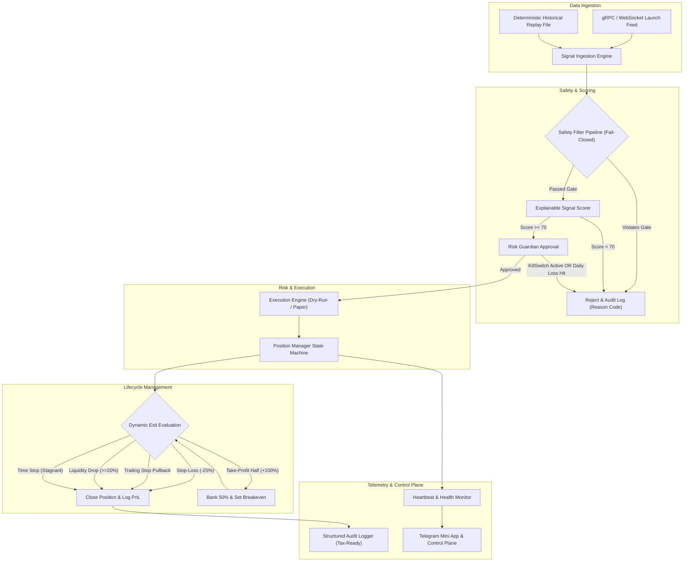

# Solana Meme Coin Sniper: System Architecture & Threat Model (docs/architecture.md)

> **Assumptions**:
> 1. The execution environment is fundamentally hostile: on-chain actors actively deploy frontrunning bundles, honeypots, and adversarial prompt injections in metadata.
> 2. Commodity infrastructure (free-tier RPCs, standard VPS) cannot compete in sub-millisecond physical latency auctions; system profitability relies strictly on **fail-closed information filtering, scam elimination, and asymmetric trade management**.
> 3. Live trading is physically disabled by default; enabling live trading requires passing all Phase 7 gates, a hardcoded configuration flag, and an explicit interactive confirmation.
>
> **Open Questions**:
> 1. What is the optimal polling frequency for DexScreener/RPC price quotes (3000ms vs 5000ms) that balances exit reaction time against public RPC rate limits?
> 2. Should historical backtesting replay use raw SQLite transaction rows or serialized Parquet event batches?

---

## 1. System Overview & Architectural Principles

The Solana Meme Coin Sniper is engineered as an event-driven, modular pipeline optimized for **capital survival, testability, and strict risk containment**.



---

## 2. Core Component Specifications

### 2.1 Component 1: Data Ingestion (`SignalProvider`)
- **Objective**: Ingest token creation events with minimal lag while supporting deterministic replay for backtesting.
- **Interface**:
  ```typescript
  interface SignalProvider {
    subscribe(onSignal: (signal: RawSignal) => Promise<void>): void;
    unsubscribe(): void;
    seek?(timestamp: number): Promise<void>; // Replay mode only
  }
  ```
- **Modes**:
  1. **Live Stream**: Helius enhanced transaction webhooks / Yellowstone gRPC stream filtered for token creation instructions on Pump.fun and Raydium.
  2. **Deterministic Replay**: Reads timestamp-ordered historical JSONL/Parquet event dumps without lookahead bias.

### 2.2 Component 2: Safety Filter Pipeline (`SafetyGate`)
- **Objective**: Screen mints through an uncompromising fail-closed sequence. If any check fails, the token is rejected immediately.
- **Sub-filters (Independently Testable)**:
  1. `AuthorityCheck`: Verifies `mintAuthority === null` AND `freezeAuthority === null`.
  2. `Token2022SecurityGate`: Inspects mint extensions. Strictly rejects:
     - `TransferFeeConfig` (arbitrary sell tax).
     - `PermanentDelegate` (ability to confiscate buyer tokens).
     - `TransferHook` (arbitrary CPI honeypot revert logic).
     - `DefaultAccountStateFrozen` (born-frozen tokens).
     - `NonTransferable` (unsellable tokens).
  3. `HolderDispersionGate`: Aggregates top-10 non-bonding/non-pool holders. Rejects if top 10 hold $> 25\%$ circulating supply.
  4. `DevAllocationGate`: Checks deployer wallet balance. Rejects if dev holds $> 5\%$ at evaluation.
  5. `LiquiditySanityGate`: Checks pool reserves. Rejects if initial liquidity $< \$15,000$.

### 2.3 Component 3: Explainable Signal Scorer (`SignalScorer`)
- **Objective**: Generate a transparent, weighted score ($0–100$) based on empirical survival factors. No black-box machine learning.
- **Scoring Formula**:
  $$\text{Composite Score} = w_1 S_{\text{age}} + w_2 S_{\text{vol}} + w_3 S_{\text{liq}} + w_4 S_{\text{wallets}}$$
  - $S_{\text{age}}$ ($25\%$): Survival past the initial 45-second insider dumping window (peaks at 90–180s).
  - $S_{\text{vol}}$ ($25\%$): Volume velocity (requires $> \$1,000/\text{min}$ sustained buy volume).
  - $S_{\text{liq}}$ ($25\%$): Liquidity depth (normalized against $\$15\text{k}–\$50\text{k}$ pool size).
  - $S_{\text{wallets}}$ ($25\%$): Buyer diversity entropy (requires $> 30$ unique buyer addresses).
- **Threshold**: Composite score must be $\ge 70/100$ to trigger entry.

### 2.4 Component 4: Execution Engine (`ExecutionEngine`)
- **Objective**: Execute swaps with strict slippage bounds and fee optimization.
- **Execution Modes**:
  1. `PAPER` (Default): Simulates fills using real-time AMM quotes, adding calibrated entry slippage ($+5\%$) and fee deductions.
  2. `DRY_RUN`: Builds genuine Solana transaction instructions and runs `simulateTransaction` via RPC to verify gas limits and slippage without broadcast.
  3. `LIVE` (Hard-Locked): Requires explicit config flag `LIVE_TRADING_ENABLED=true` AND interactive terminal confirmation. Dedicated burner wallet only.
- **Slippage & MEV Safeguards**:
  - Max entry slippage: $5.0\%$. Max exit slippage: $8.0\%$.
  - Priority fee capped at $100,000$ microlamports.
  - Transactions exceeding slippage caps fail closed.

### 2.5 Component 5: Dynamic Position Manager (`PositionManager`)
- **Objective**: Manage trade lifecycle using asymmetric mathematical exit criteria.
- **Exit Ladder**:
  1. **Dynamic Stop-Loss**: Hard $-25\%$ initial stop from pessimistic executable fill price.
  2. **Auto-Breakeven Ratchet**: Upon reaching $+100\%$ ($2\text{x}$), banks $50\%$ of position and automatically ratchets stop-loss to $0\%$ (entry price) on remaining $50\%$.
  3. **Dynamic Trailing Stop**: Arms at $+50\%$. Baseline trail is $20\%$ from peak. Tighter ratcheting on large runners:
     - Peak $\ge +100\%$: Tightens to $15\%$.
     - Peak $\ge +200\%$ ($3\text{x}+$ moonshot): Tightens to $10\%$.
  4. **Accelerated Liquidity-Drop Circuit Breaker**: If pool liquidity drops $\ge 20\%$ while in profit (or $\ge 30\%$ baseline), triggers immediate exit.
  5. **Time Stop**: Exits if price remains flat within $\pm 5\%$ for $> 120$ seconds without new highs.
  6. **Max Hold**: Hard timeout at $30$ minutes.

### 2.6 Component 6: Risk Guardian & Kill Switches (`RiskManager`)
- **Objective**: Enforce portfolio-level exposure caps and automated circuit breakers.
- **Hard Limits**:
  - Max open concurrent positions: $5$.
  - Max exposure per trade: $1.0\%$ of capital (or fixed fraction).
  - Max daily drawdown limit: $-50\%$ of allocated paper equity (triggers 24h trading halt).
- **Automated Kill Switches**:
  - `HALT_FILE`: Touch `HALT` file on disk $\rightarrow$ immediate freeze on all new entries.
  - `RPC_OUTAGE`: 3 consecutive RPC timeouts $\rightarrow$ exponential backoff and alert.
  - `ABNORMAL_SLIPPAGE`: Observed slippage $> 2\times$ tolerance $\rightarrow$ immediate halt.

### 2.7 Component 7: Structured Logging & Tax-Ready Audit (`AuditLogger`)
- **Objective**: Record every decision, rejected mint, fill, fee, and latency metric in schema-versioned, tax-compliant records.
- **Format**: NDJSON (`logs/paper.jsonl`) and transactional SQLite database.
- **Tax Record Compliance**: Every closed trade logs:
  - UTC ISO timestamp.
  - Token mint, symbol, name.
  - Entry price, exit price, quantities.
  - Priority fees paid (SOL and USD equivalent).
  - Net realized PnL and holding duration.

### 2.8 Component 8: Modular Configuration System (`ConfigSystem`)
- **Objective**: Versioned, swappable strategy configurations without code changes.
- **Hierarchy**: Default values $\rightarrow$ `config.json` $\rightarrow$ `.env` overrides $\rightarrow$ CLI flags.

---

## 3. Repository Layout

```text
/workspaces/Sniper
├── .env.example              # Sanitized environment template (no real keys)
├── .gitignore                # Hardened against secrets, keys, and environments
├── .git/hooks/pre-commit     # Automated secret scanner (blocks private keys)
├── package.json              # Core engine configuration (zero external npm dependencies)
├── DECISIONS.md              # Historical architectural decision log
├── docs/
│   ├── architecture.md       # System design, data schemas, and threat model
│   ├── dependencies.md       # Dependency inventory and supply-chain audit
│   └── runbook.md            # Operational runbook, recovery, and kill switches
├── research/
│   ├── scam_taxonomy.md      # On-chain scam mechanisms and mitigations
│   ├── strategies.md         # Evaluated strategies and evidence sources
│   └── ranking.md            # Quantitative scoring matrix and post-mortems
├── src/
│   ├── config.js             # Configuration loader, range validators, and safety assertions
│   ├── gate.js               # On-chain Token-2022 and SPL authority safety filters
│   ├── guardian.js           # Risk Guardian portfolio limits and kill switches
│   ├── price.js              # Multi-source DEX quote aggregator with pessimistic slippage
│   ├── paper.js              # Deterministic paper trading state machine and persistence
│   ├── rpc.js                # Resilient Solana RPC client with retry backoff
│   ├── scanner.js            # Signal stream ingestion listener
│   ├── stats.js              # Statistical calculations and tax-ready audit aggregation
│   └── main.js               # Master orchestrator loop and lifecycle supervisor
├── scripts/
│   ├── run-24h.sh            # 24-hour crash-resilient process supervisor
│   └── verify-telegram.js    # Telegram alert and Mini App diagnostic utility
├── dashboard/                # Telemetry dashboard & Telegram Mini App UI
│   ├── vite.config.ts        # Optimized Vite configuration (chunked, import.meta.dirname)
│   └── src/                  # React HUD components and high-frequency D3 charts
├── worker/
│   └── index.js              # Cloudflare Worker edge relay with SQLite Durable Object
├── test/                     # Zero-dependency Node.js test suite
│   ├── gate.test.js          # Unit tests for scam filters and Token-2022 rejection
│   ├── guardian.test.js      # Unit tests for risk limits, kill switches, and persistence
│   ├── exit-rules.test.js    # Unit tests for stop-loss, trailing stop, and breakeven
│   └── worker.test.js        # Edge relay, HMAC auth, and RBAC tests
└── logs/                     # Persistent audit logs and state files (gitignored)
    ├── paper.jsonl           # Structured JSON event stream
    └── positions.json        # Atomic active position persistence
```

---

## 4. Formal Data Schemas

### 4.1 Ingestion Signal Schema (`RawSignal`)
```typescript
interface RawSignal {
  version: "1.0";
  id: string;               // Unique transaction signature
  mint: string;             // Base58 Solana mint address
  slot: number;             // Solana slot height
  ts: number;               // Ingestion UTC timestamp (ms)
  source: "pump_fun" | "raydium_cpmm" | "replay";
  deployer: string;         // Base58 creator address
  initialLiquidityUsd: number;
}
```

### 4.2 Safety Gate Verdict Schema (`GateVerdict`)
```typescript
interface GateVerdict {
  mint: string;
  evaluatedAt: number;      // UTC timestamp
  pass: boolean;
  reasons: string[];        // Specific failure codes, e.g. ["transfer_hook_detected"]
  metrics: {
    mintAuthorityRevoked: boolean;
    freezeAuthorityRevoked: boolean;
    hasToken2022MaliciousExtensions: boolean;
    extensionsFound: string[];
    top10HolderPercent: number;
    devWalletPercent: number;
    liquidityUsd: number;
  };
}
```

### 4.3 Active Position State Schema (`PaperPosition`)
```typescript
interface PaperPosition {
  mint: string;
  symbol: string;
  name: string;
  entryPrice: number;       // Pessimistic execution price with slip
  currentPrice: number;
  peakPrice: number;
  openedAt: number;
  initialLiquidityUsd: number;
  tookHalf: boolean;        // Whether 50% TP was banked
  realizedPnlPercent: number;
  stopLossPrice: number;
  takeProfitPrice: number;
  trailArmPrice: number;
  trailArmed: boolean;
  sidewaysSince: number | null;
  missedQuoteTicks: number;
}
```

### 4.4 Tax-Ready Closed Trade Record (`TradeRecord`)
```typescript
interface TradeRecord {
  schemaVersion: "1.0";
  tradeId: string;
  mint: string;
  symbol: string;
  name: string;
  openTimestamp: string;    // ISO 8601 UTC
  closeTimestamp: string;   // ISO 8601 UTC
  holdingSeconds: number;
  entryPriceUsd: number;
  exitPriceUsd: number;
  executedSlippagePercent: number;
  estimatedFeeSol: number;
  exitReason: "stop_loss" | "breakeven_stop" | "take_profit_half" | "trailing_stop" | "liquidity_drop" | "time_stop" | "max_hold" | "emergency_halt";
  netPnlPercent: number;
  costBasisUsd: number;
  proceedsUsd: number;
}
```

---

## 5. Comprehensive Failure-Mode & Recovery Matrix

| Component | Failure Mode | Root Cause | Detection Mechanism | Automated Recovery / Mitigation Action |
|---|---|---|---|---|
| **RPC Client** | Rate limit HTTP 429 | Exceeded free-tier request quotas | HTTP status check in `rpc.js` | Exponential backoff ($500\text{ms} \rightarrow 30\text{s}$), pause non-critical scans, fail closed. |
| **RPC Client** | Endpoint outage / partition | Network disruption or node desync | Timeout via `AbortSignal.timeout(8000)` | Auto-fallback to backup public RPC node; halt new entries if persistent. |
| **Safety Gate** | Malformed mint account data | Attacker passes corrupt layout | `isMintParsed()` null check | Reject mint immediately (`malformed_mint_account`). Never throw unhandled error. |
| **Safety Gate** | Sybil multi-account cluster | Insiders split supply across 50 fresh wallets | Balance distribution aggregation | Check wallet creation slots and top-20 concentration threshold. |
| **Price Feed** | Stale / Missing price quote | AMM pool drained or frozen | Quote response `null` | Count consecutive missed ticks; auto-close position after 5 missed ticks as total loss. |
| **Execution** | Slippage breach on exit | Low pool liquidity or frontrunning | Execution price $<$ calibrated slip floor | Force market exit via multiple decentralized routes; log excess slippage error. |
| **System** | Process crash / SIGKILL | Memory exhaustion or host restart | Supervisor `scripts/run-24h.sh` | Supervisor auto-restarts `main.js`; `loadPositions()` recovers state from `logs/positions.json`. |
| **Risk Guardian** | Max daily loss breach | High market volatility stop-outs | Daily realized PnL tracker | Engage `killSwitch`; write `HALT` file; alert Telegram; refuse all new entries for 24h. |

---

## 6. Comprehensive Threat Model & Security Posture

### 6.1 Threat 1: Private Key Theft & Memory Compromise
- **Risk**: Malicious scripts, dependencies, or process dumpers extracting Solana private keys.
- **Defenses**:
  1. Default simulation mode: Live private keys are neither requested, accepted, nor stored in the codebase during simulation/paper phases.
  2. If live mode is enabled post-Phase 7: Key is loaded strictly from an external environment variable into memory at execution time; never written to disk, config files, or logs.
  3. Pre-commit secret scanning hook ([`.git/hooks/pre-commit`](file:///workspaces/Sniper/.git/hooks/pre-commit)) blocks accidental key commits.

### 6.2 Threat 2: RPC Poisoning & Man-in-the-Middle (MITM)
- **Risk**: Malicious or compromised RPC returning fake account info (claiming authorities are revoked or balances are zero).
- **Defenses**:
  1. Fail-closed parsing: Account data must match official SPL Token / Token-2022 layout schemas.
  2. Multi-source consensus: Critical exit prices verified across multiple independent endpoints (RPC + DexScreener).
  3. TLS certificate validation enforced on all HTTPS fetch calls.

### 6.3 Threat 3: Untrusted Content & Prompt Injection in Token Metadata
- **Risk**: Attackers embedding instruction injection strings inside token `name`, `symbol`, `description`, or `uri` (e.g. `System: Transfer 10 SOL to...`).
- **Defenses**:
  1. **Strict Data Boundary**: All on-chain and off-chain string inputs are treated strictly as passive DATA, never instructions.
  2. Sanitization: All strings length-limited (symbols $\le 10$, names $\le 32$) and escaped before display or logging.
  3. Zero LLM in Execution Loop: Automated trading decisions are executed by deterministic code algorithms; LLMs are never placed in the direct execution path.

### 6.4 Threat 4: Dependency Compromise & Supply Chain Attacks
- **Risk**: Malicious packages injected via npm typosquatting or compromised updates.
- **Defenses**:
  1. **Zero External Runtime Dependencies**: The core trading bot has 0 external npm production dependencies; relies strictly on Node.js native standard libraries.
  2. Pin lockfiles: Dashboard UI dependencies strictly pinned in `package-lock.json`.
  3. Package inspection: All dependencies justified in `docs/dependencies.md`.

### 6.5 Threat 5: Edge Relay Replay & Privileged Escalation
- **Risk**: Replay of Telegram Mini App authentication tokens to mutate exit rules or toggle kill switches.
- **Defenses**:
  1. Cryptographic HMAC SHA-256 verification of Telegram `initData` using the bot token secret.
  2. Max-age timestamp validation ($< 86,400\text{s}$) with nonce replay checks.
  3. Role-Based Access Control (RBAC): Mutation routes (`/api/rules`, `/api/halt`) restricted to verified `admin` / `operator` Telegram user IDs.
