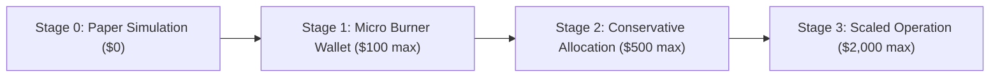

# Capital Management & Phased Allocation Plan (ops/capital_plan.md)

> **Core Principle**: Capital survival precedes all return targets. Start only with capital you can afford to lose entirely. Never scale position sizing automatically after winning streaks.

---

## 1. Legal & Tax Compliance Mandate

### Jurisdictional Reminder
Before any live execution can ever be considered:
1. Confirm the legality of automated algorithmic cryptocurrency trading, decentralized exchange interaction, and memecoin holding within your specific tax jurisdiction.
2. Cryptocurrency transactions on Solana (including swaps, liquidity provisioning, and token sales) are taxable events in most jurisdictions (e.g. IRS Capital Gains in the US, HMRC in the UK, etc.).
3. **Tax-Ready Accounting**: Every trade record logged by `src/paper.js` and `src/log.js` contains:
   - UTC ISO 8601 timestamp.
   - Solana mint address, symbol, and name.
   - Exact entry and exit prices (USD and SOL).
   - Priority fees paid (transaction fee + tip).
   - Realized net profit/loss and holding duration in seconds.

---

## 2. Phased Capital Staging (If Live Gate Ever Passes)

Live trading remains **physically locked** until Phase 7 gates are satisfied. If in the future an approved evaluation passes, capital must follow strict milestone staging:

### Stage 0: Paper Simulation (Current Phase)
- **Capital at Risk**: $\mathbf{\$0.00}$.
- **Objective**: Validate execution latency, fill rates, and expectancy across $N \ge 150-200$ live market signals.
- **Requirement to Advance**: Minimum $N=150$ paper trades with positive expectancy ($E > +5\%$) and 0 honeypot/rug hits.

### Stage 1: Micro Burner Wallet
- **Maximum Total Capital**: $\mathbf{\$100.00}$ (or $\approx 0.5$ SOL).
- **Position Sizing**: $\$5.00$ to $\$10.00$ per trade (fixed allocation).
- **Wallet Architecture**: Isolated burner keypair generated outside the repo; loaded via temporary environment variable; zero access to primary personal wallets.
- **Milestone to Advance**: 100 live trades executed with positive net PnL after all priority fees and zero unexpected balance deviations.

### Stage 2: Conservative Allocation
- **Maximum Total Capital**: $\mathbf{\$500.00}$ (or $\approx 2.5$ SOL).
- **Position Sizing**: $1.0\%$ to $2.0\%$ Capped Fractional Kelly ($f \le 0.02$).
- **Milestone to Advance**: 200 consecutive live trades with maximum drawdown $< 15\%$ and positive Sharpe ratio.

### Stage 3: Scaled Operation (Capacity Ceiling)
- **Maximum Total Capital**: $\mathbf{\$2,000.00}$.
- **Capacity Ceiling**: Due to bonding-curve price impact ($I = \frac{\Delta x}{x + \Delta x}$), meme coin order sizes $> \$200-\$300$ move the market against the sniper. Capital beyond $\$2,000$ must not be allocated to a single sniper bot instance.

---

## 3. Asymmetric Scaling Invariants
1. **Never Auto-Scale After Wins**: Positive performance never automatically increases trade dollar sizing. Winnings must be swept to cold storage weekly.
2. **Defensive Drawdown Scaling**: If daily drawdown reaches $25\%$, trade sizing is immediately halved ($50\%$ cut). If daily drawdown reaches $50\%$, trading halts for 24 hours.
