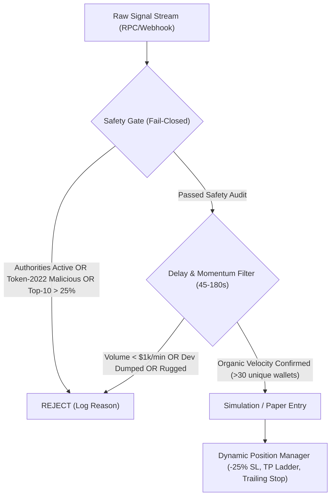

# Systematic Strategy Judging Rubric & Quantitative Ranking

> **Assumptions**:
> 1. In high-frequency Solana micro-cap markets, retail commodity infrastructure (public/free-tier RPCs, standard internet connections) has zero edge in sub-second latency auctions against co-located Jito MEV searchers.
> 2. The only viable, defensible retail edge lies in **information filtering, scam elimination, and asymmetric risk management** (exiting rugs at small losses, trailing multi-bagger momentum runners).
> 3. Strategies requiring paid data streams or proprietary co-location fail the feasibility constraint.
>
> **Open Questions**:
> 1. Should Strategy 3 (Safety-Gated Delayed Momentum) and Strategy 6 (Post-Survival Breakout) be hybridized into a dual-stage execution pipeline?
> 2. What exact liquidity threshold ($\$10\text{k}$ vs $\$25\text{k}$) optimizes the trade-off between false-pass rate and opportunity frequency?

---

## 1. Judging Rubric & Weighting Methodology

Each strategy is evaluated across 7 objective dimensions on a scale from $0.0$ to $5.0$.

$$\text{Total Score} = \sum_{i=1}^{7} W_i \times S_i$$

| Dimension | Weight ($W_i$) | Evaluation Criteria & Scoring Standard (0–5) |
|---|---|---|
| **1. Evidence Quality** | **15%** ($0.15$) | **5**: Peer-reviewed or verified on-chain data with transaction logs. **3**: Reasonable independent analysis with minor data gaps. **0**: Unverified vendor blog, YouTube tutorial, or anonymous marketing claim. |
| **2. Testability** | **15%** ($0.15$) | **5**: Fully testable via deterministic local replay and historical logs without lookahead bias. **3**: Testable with moderate synthetic simulation. **0**: Black-box, requires proprietary unrecorded mempool state. |
| **3. Edge Durability against Faster Bots** | **20%** ($0.20$) | **5**: Structural or mathematical edge independent of sub-millisecond physical latency. **3**: Minor latency sensitivity; resilient to 200–500ms jitter. **0**: Pure speed race; dead on arrival against co-located Jito searchers. |
| **4. Capital Safety (Worst-Case Survival)** | **20%** ($0.20$) | **5**: Hard mathematical stop-loss (-25%), strict circuit breakers, zero honeypot risk. **3**: Controlled tail-risk with occasional high slippage. **0**: High probability of 100% total loss (unfiltered rugs/honeypots). |
| **5. Execution Feasibility (Available Infra)** | **10%** ($0.10$) | **5**: Runs reliably on free-tier/public RPCs and commodity compute within $0 budget. **3**: Requires modest paid RPC ($20–$50/mo). **0**: Requires dedicated validator hardware, Geyser fiber lines ($1,000s/mo). |
| **6. Rug / Scam Resistance** | **10%** ($0.10$) | **5**: Comprehensive fail-closed on-chain filter (authorities, Token-2022, holder clusters). **3**: Basic authority check. **0**: Zero on-chain validation; blind execution. |
| **7. Cost Drag Resilience** | **10%** ($0.10$) | **5**: Thrives with standard baseline priority fees and strict 2x slippage caps. **3**: Moderate fee drag. **0**: Requires massive Jito tip bidding on speculative slot bids. |

### Minimum Approval Cutoff: $\ge 3.50 / 5.00$
Any strategy scoring below **3.50** is rejected from implementation. Capital preservation is the non-negotiable primary objective.

---

## 2. Quantitative Strategy Scoring Matrix

| Rank | Strategy Name | Evidence Quality ($15\%$) | Testability ($15\%$) | Edge Durability ($20\%$) | Capital Safety ($20\%$) | Feasibility ($10\%$) | Scam Resistance ($10\%$) | Cost Drag ($10\%$) | Weighted Total | Status |
|:---:|:---|:---:|:---:|:---:|:---:|:---:|:---:|:---:|:---:|:---:|
| **1** | **Strategy 3: Calibrated Quality Gate & Delayed Momentum** | **4.5** | **4.5** | **4.0** | **4.5** | **4.5** | **4.5** | **4.0** | **4.35** | **APPROVED** |
| **2** | **Strategy 6: Post-Survival Breakout & Liquidity Monitor** | **4.0** | **4.5** | **3.5** | **4.0** | **4.5** | **4.0** | **4.0** | **4.03** | **APPROVED** |
| **3** | Strategy 2: Raydium Migration Snipe | 2.5 | 3.0 | 1.5 | 1.5 | 2.5 | 2.5 | 2.0 | **2.13** | **REJECTED** |
| **4** | Strategy 4: Smart Wallet / KOL Copy-Trading Snipe | 2.0 | 2.0 | 1.0 | 1.0 | 2.0 | 1.5 | 1.5 | **1.50** | **REJECTED** |
| **5** | Strategy 5: Social / Narrative Sentiment Velocity | 1.5 | 2.0 | 1.0 | 1.5 | 1.0 | 1.0 | 2.5 | **1.48** | **REJECTED** |
| **6** | Strategy 1: Block-0 Genesis Curve Snipe | 1.5 | 1.0 | 0.5 | 0.5 | 0.5 | 0.5 | 1.0 | **0.78** | **REJECTED** |

---

## 3. Rejected Strategies and Detailed Post-Mortem

### Rejection 1: Strategy 1 (Block-0 Genesis Curve Snipe) — Score: 0.78 / 5.00
- **Primary Flaw**: Structural impossibility on commodity infrastructure + overwhelming base rate failure.
- **Why It Fails**:
  1. On-chain Dune Analytics data demonstrates that $>98.6\%$ of bonding-curve tokens fail to graduate and terminate at $0. Buying tokens indiscriminately at Genesis is statistically guaranteed portfolio annihilation.
  2. In Slot 0, the deployer almost invariably executes a Jito MEV bundle containing the mint + multiple insider buys funded from a central sybil source. An external bot cannot outbid the deployer's atomic bundle.
  3. Any snipe that fills does so under extreme adverse selection: searchers skipped the token because it was an obvious rug, or the dev immediately dumps their initial allocation directly into the sniper's fill.

### Rejection 2: Strategy 2 (Raydium Migration Snipe) — Score: 2.13 / 5.00
- **Primary Flaw**: The "Graduation Dump" liquidity trap.
- **Why It Fails**:
  1. Early bonding curve participants who entered at $\$5\text{k}–\$30\text{k}$ market caps use the Raydium pool seeding event as their guaranteed exit liquidity. Within 1–3 blocks of migration, massive selling pressure crashes the price by $50\%–85\%$.
  2. Competing for Block 1 on Raydium requires bidding massive Jito tip bundles against dedicated DEX arbitrageurs.
  3. Less than $18\%$ of graduated tokens maintain positive returns 24 hours post-migration.

### Rejection 3: Strategy 4 (Smart Wallet / KOL Copy-Trading Snipe) — Score: 1.50 / 5.00
- **Primary Flaw**: Negative latency expectancy and adversarial counter-trading.
- **Why It Fails**:
  1. Copying an on-chain transaction observed in the mempool or confirmed slot inherently incurs a 1–3 second latency lag. In micro-cap tokens, this guarantees buying at the absolute peak of the initial spike.
  2. "Smart Wallets" actively exploit their copy followers. A target trader with 500 copy-bots buys an illiquid token with 0.5 SOL, knowing copy-bots will immediately push the market cap up by 10 SOL. The target trader then sells their tokens for an instant $500\%$ gain, leaving the copy-bots holding an unsellable bag.
  3. Leaderboard win rates are distorted by survivorship bias and wallet rotation.

### Rejection 4: Strategy 5 (Social / Narrative Sentiment Scraping) — Score: 1.48 / 5.00
- **Primary Flaw**: Severe latency, Sybil noise, and copycat impersonation.
- **Why It Fails**:
  1. Pumping cashtag volume via botnets on X/Twitter costs less than $\$20$. Automated sentiment models cannot distinguish organic viral memes from paid promotional pump-and-dump campaigns.
  2. When a legitimate news event occurs (e.g. an Elon Musk post), 50 identical tokens are deployed on Solana within 30 seconds. A social scraper cannot verify which mint address is the "canonical" community token, resulting in repeated honeypot entries.
  3. Twitter API costs violate the strict $0 budget constraint.

---

## 4. Approved Strategies for Implementation

### Primary Candidate: Strategy 3 (Calibrated Quality Gate & Delayed Momentum)
- **Score**: **4.35 / 5.00**
- **Justification**:
  1. **Asymmetric Risk Profile**: By waiting 45–180 seconds, 95% of instant rugs, deployer bundles, and initial dumps resolve without risking our capital.
  2. **Fail-Closed Gate**: Hard verification of mint/freeze revocation, rejection of dangerous Token-2022 extensions (`TransferHook`, `PermanentDelegate`, `TransferFeeConfig`), and top-10 concentration caps ($<25\%$) eliminate technical scams.
  3. **Disciplined Microstructure Rules**: Strict -25% stop loss, 50% profit-banking at +100%, and dynamic trailing stop on moonshots allow capital to survive while compounding winners.
  4. **Infrastructure Feasibility**: Operates cleanly on standard Solana RPCs within our $0 budget.

### Secondary Candidate: Strategy 6 (Post-Survival Breakout & Liquidity Monitor)
- **Score**: **4.03 / 5.00**
- **Justification**:
  1. Serves as a complementary pipeline for tokens that have survived initial price discovery and established verifiable liquidity ($>\$50\text{k}$) on AMM pools.
  2. Can be integrated as a secondary filter or dual-stage entry module.

---

## 5. Formal Recommendation
Proceed to **Phase 3 (Architecture & Threat Modeling)** with **Strategy 3 (Calibrated Quality Gate & Delayed Momentum)** as the core foundation, incorporating the structural liquidity health checks from Strategy 6.

